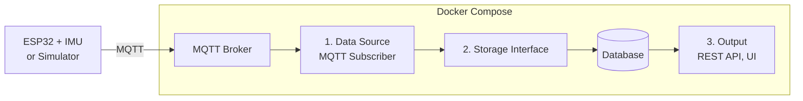

# IMU Motion Logger

An ESP equipped with an IMU (Inertial Measurement Unit) publishes acceleration and velocity data to an MQTT broker. Our Python application subscribes to these messages, stores them in a database, exposes the data via a REST API, and supports CSV exports.

---

## Team

| Name | Rolle | Focus |
|---|---|---|
| _Florian Kuhn_ | Product Owner + Developer | _Ingestion Service_ |
| _Jan Krummenacher_ | Scrum Master + Developer | _MQTT-Broker_ |
| _Simon Schurti_ | Developer | _Front End_ |
| _Simon Ladner_ | Developer | _Database_ |
| _Mathias Ambaun_ | Developer | _IMU Simulation_ |


---

## Idea

| Component | Implementation |
|---|---|
| **1. Data Source** | An ESP32 or Raspberry Pi Pico W with an IMU periodically publishes measurement data to an MQTT topic. A **simulator** sends the same message format so the app can be developed and tested without hardware and started via `docker compose up`. If the broker goes down, the app logs the error and reconnects later. 
| **2. Storage** | Results and events are written to a database through a storage interface. The data persists across container restarts. |
| **3. Output** | A REST API for querying measurements and events for frontend visualization, plus CSV export |
| **4. Konfiguration** | Settings (broker, topics, thresholds, window size, DB) are stored in `config.ini`, while credentials (MQTT password, DB password) are kept solely in `.env`. |



---

## Scope

### In version 1
- A sensor node (ESP32) sends raw data (acceleration, angular rate) at a fixed interval via MQTT
- Simulator with an identical message format
- MQTT configuration of the sensor node: transmission frequency and time synchronization with acknowledgment
- Python app: receive, validate, process, and store MQTT messages
- Database with an interchangeable storage interface
- REST API (to query measurements and events) for the frontend and optionally CSV export
- Configuration via `config.ini`, secrets via `.env`
- Docker Compose, unit tests, and CI pipeline according to the guidelines

### Not in version 1 (Ideas for the future)

- Additional commands sent to the node via MQTT (e.g., calibration)
- Logic: tilt/inclination, motion state, statistics per time window
- Web interface with charts
- Multiple sensor nodes simultaneously
- TLS encryption, over-the-air (OTA) firmware updates
- 3D orientation visualization

---

## Project Organization

- Backlog: GitHub Issues with description and Definition of Done
- Sprint = time between lectures
- Retrospectives: [`docs/retro.md`](docs/retro.md)
- Architecture: [`docs/architecture.md`](docs/architecture.md)


---
## Development Process and Community Rules
### Git 

NEVER PUSH TO MAIN!


### Commit messages

**The structure:**

```
<type>[optional scope]: <description>

[optional body]

[optional footer(s)]
```

| Part | Rule |
|---|---|
| **type** | Required. A noun like `feat` or `fix`. Then the optional scope, the optional `!`, and a colon with a space. |
| **scope** | Optional. A noun in parentheses that names the part of the code, for example `fix(parser):`. |
| **description** | Required. A short summary directly after the colon and space. |
| **body** | Optional. Free text, as many paragraphs as you need. It starts one blank line after the description. |
| **footer(s)** | Optional. Starts one blank line after the body. Format: `Token: value` or `Token #value`. Use `-` instead of spaces in the token (for example `Reviewed-by`). `BREAKING CHANGE` is the only exception. |

**Commit types:**

| Type | Description |
|---|---|
| `build` | Changes that affect the build system or external dependencies |
| `chore` | Changes that do not relate to a fix or feature and don't modify src or test files (for example updating dependencies) |
| `ci` | Changes to CI configuration files and scripts |
| `docs` | Documentation only changes |
| `feat` | A new feature |
| `fix` | A bug fix |
| `perf` | A code change that improves performance |
| `refactor` | A code change that neither fixes a bug nor adds a feature |
| `style` | Changes that do not affect the meaning of the code (white-space, formatting, missing semi-colons, etc) |
| `test` | Adding missing tests or correcting existing tests |

**Breaking changes:**

A breaking change is a change that can break the code of the people who use your code. It can be part of a commit of **any** type.

- Add `!` directly before the colon: `feat(api)!: remove v1 endpoints`


If you use `!`, you can skip the footer. Then the description must explain the breaking change.

### Branch Naming convention 

Branch names use the same types as commit messages. So a branch and its commits describe the work in the same way.

## MQTT Broker (Docker)
The MQTT-Broker runs as a ontainer with **Eclipse Mosquitto** (`eclipse-mosquitto:2.1.4-alpine`) on the shared Docker network `iot-net` and listens on port `1883`.

**Start the docker with the mqtt-brocker:**
```bash
docker compose up -d
docker compose ps
docker compose logs --tail 20
```

**Stop the container**
```bash
docker compose down
```

**Local function Test**
Terminal 1 - start subscriber:
```bash 
docker exec -it mosquitto mosquitto_sub -h localhost -p 1883 -t "sensors/v1/#" -v
```
Terminal 2 - send testmessage:
```bash
docker exec -it mosquitto mosquitto_pub -h localhost -p 1883 -t "sensors/v1/esp32-01/imu/imu-01/measurements" -m '{"device_id":"esp32-01","sensor_id":"imu-01","message_counter":0,"boot_counter":1}'
```
If every thing runs correct the sented message shoult pop up in the Terminal 1.

---
## Getting Started

_kommt noch..._

## Architecture 

- C4 can be found [here](docs/architecture.md)  

