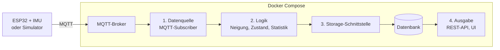

# IMU Motion Logger

Ein ESP32 mit Inertialsensor (IMU) sendet Beschleunigungs- und Drehratendaten per MQTT. Unsere Python-App empfängt die Daten, wertet sie aus (Neigung, Bewegungszustand, Statistik), speichert die Ergebnisse in einer Datenbank und stellt sie über eine REST-API und einen CSV-Export zur Verfügung.

Schulprojekt im Modul Software Engineering (Leistungsnachweis).

---

## Team

| Name | Rolle | Schwerpunkt |
|---|---|---|
| _Name_ | Product Owner + Developer | _tbd_ |
| _Name_ | Scrum Master + Developer | _tbd_ |
| _Name_ | Developer | _tbd_ |
| _Name_ | Developer | _tbd_ |

Alle Teammitglieder schreiben Code im Python-Teil und erstellen eigene Pull Requests.

---

## Idee

| Baustein | Umsetzung |
|---|---|
| **1. Datenquelle** | ESP32 oder Rpi Pico W + IMU publiziert Messdaten periodisch auf ein MQTT-Topic. Ein **Simulator** sendet dasselbe Nachrichtenformat, damit die App ohne Hardware entwickelt, getestet und mit `docker compose up` gestartet werden kann. Fällt der Broker aus, loggt die App den Fehler und verbindet sich später neu. |
| **2. Logik** | Berechnung der Neigung (Roll/Pitch) aus der Beschleunigung, Erkennung des Bewegungszustands (Ruhe / Bewegung / Stoss) über Schwellwerte, Statistik pro Zeitfenster (Min, Max, Mittelwert, RMS). |
| **3. Speicherung** | Ergebnisse und Ereignisse über eine Storage-Schnittstelle in einer Datenbank. Die Daten überleben einen Neustart des Containers. |
| **4. Ausgabe** | REST-API zum Abfragen der Messwerte und Ereignisse für Visualisierung auf einem Frontend sowie CSV-Export. |
| **5. Konfiguration** | Einstellungen (Broker, Topics, Schwellwerte, Fenstergrösse, DB) in `config.ini`, Zugangsdaten (MQTT-Passwort, DB-Passwort) nur in `.env`. |

---

## Scope

### In Version 1

- Ein Sensorknoten (ESP32) sendet Rohdaten (Beschleunigung, Drehrate) in festem Intervall per MQTT
- Simulator mit identischem Nachrichtenformat
- Python-App: MQTT empfangen, validieren, auswerten, speichern
- Logik: Neigung, Bewegungszustand, Statistik pro Zeitfenster
- Datenbank mit austauschbarer Storage-Schnittstelle
- REST-API (Messwerte und Ereignisse abfragen) für Frontend und evtl auch CSV-Export
- Konfiguration über `config.ini`, Secrets über `.env`
- Docker Compose, Unit-Tests, CI-Pipeline gemäss Leitfaden

### Nicht in Version 1 (Erweiterungen, falls Zeit bleibt)

- Befehle an den Knoten per MQTT (z. B. Kalibrierung mit Bestätigung)
- Web-Oberfläche mit Chart
- Mehrere Sensorknoten gleichzeitig
- TLS-Verschlüsselung, OTA-Updates der Firmware
- 3D-Visualisierung der Lage

---

## Froge an Klims

1. Darf die Firmware des ESP32 in C++ (PlatformIO) geschrieben sein, oder soll sie in MicroPython umgesetzt werden? Gehört sie zur Bewertung?
2. Ist ein MQTT-Broker als Datenquelle (statt direkt eine Web-API oder ein Sensor) in Ordnung?
3. Ist ein Simulator als Datenquelle für `docker compose up` und die Bewertung ohne Hardware ok?

---

## Projektorganisation

- Scrum-Board: _Link zu GitHub Projects_ -> TODO KF
- Backlog: GitHub Issues mit Beschreibung und Definition of Done
- Sprint = Zeit zwischen Vorlesungen
- Retrospektiven: [`docs/retro.md`](docs/retro.md)
- Architektur: [`docs/architecture.md`](docs/architecture.md) ->  TODO KF for Week3

---

## Getting Started

_kommt noch..._
