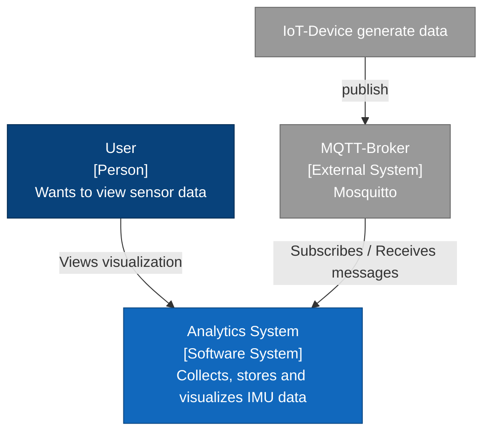
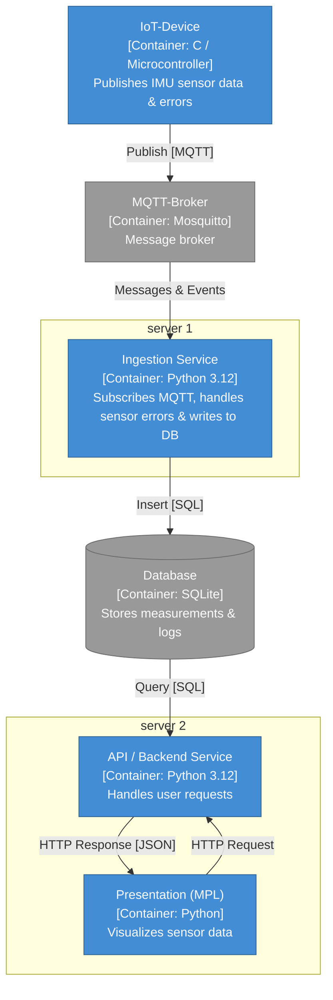
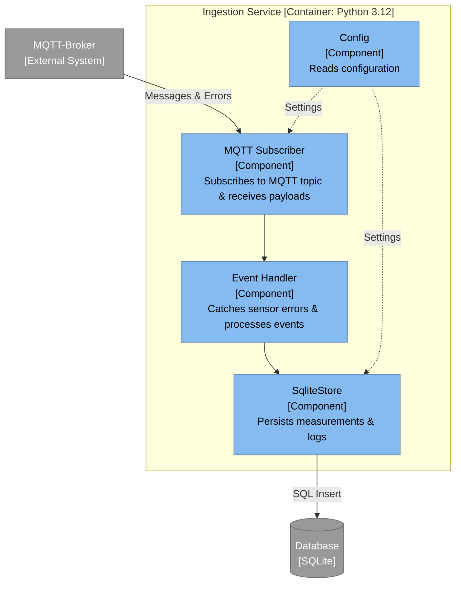
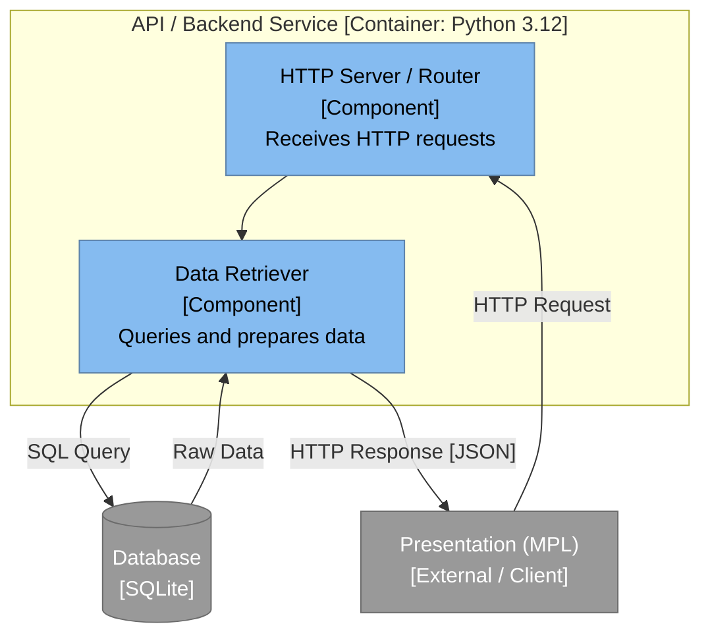
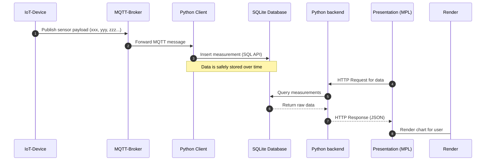

# Architecture

## Level 1 Context

An IoT sensor generates data through measurements. This data is sent to the software system via an MQTT broker. The data is stored in a database. The user can retrieve the data from the database and have it visualized.

## Level 2 Container

This diagram shows the independent runtime units (containers) of your system and how they are distributed across various devices. The IoT device publishes sensor data and error messages to the central Mosquitto broker via the MQTT protocol. The Ingestion Service receives these messages, processes events, and stores the data persistently in the SQLite database. Separately, the API/Backend Service retrieves the stored data as needed to make it available for visualization via HTTP/JSON.

## Level 3 Component

### MQTT Subscriber

The application is a subscriber to the MQTT broker. The data is checked for error messages and stored in the database.

### Backend Handler

The data is retrieved from the database upon a user's request. The data is then formatted for visualization and displayed to the user.

## Level 4 Code
We'll add this once we've started programming.
Zoom into one component. Only draw this level for the important parts, for example your storage interface.
## Dynamic view

